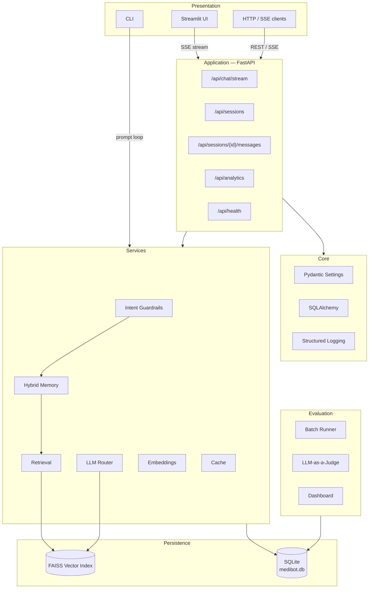

<div align="center">

# Nura

**Retrieval-augmented clinical reference assistant with hybrid memory, multi-provider LLM routing, and grounded source citations.**

Ask questions about your own medical PDFs and get answers pulled directly from those documents — not generated from model memory.

[](https://www.python.org/downloads/)
[](https://fastapi.tiangolo.com/)
[]()
[]()

</div>

---

## Features

- **Document-grounded answers** — every response cites your source PDFs; no hallucinated content
- **Hybrid memory** — 5-turn conversational buffer + rolling summary persisted to SQLite
- **Multi-provider LLM router** — Gemini primary, Groq automatic fallback
- **Medical domain guardrails** — intent classifier blocks off-topic or clinical-harm queries before they reach the model
- **FastAPI backend** — REST API + Server-Sent Events streaming for real-time token delivery
- **CLI + Streamlit web UI** — interact however you prefer
- **Production evaluation framework** — LLM-as-a-Judge scoring, golden datasets, SQLite result history, and dashboard
- **Docker-ready** — containerized build with full vector-store support

---

## Architecture



**Data flow (one chat turn):**

```
User message
  → Intent guardrail (medical only? off-topic? → reject early)
  → Memory context builder (last 5 turns + rolling summary)
  → Hybrid retrieval (history-aware query → FAISS top-K)
  → LLM router (Gemini primary → Groq on failure)
  → Compose answer with source citations
  → Stream tokens to client (SSE)
  → Log latency, provider, guardrail hits to analytics
  → Persist turn in memory (evict to summary if > buffer)
```

**Key design decisions:**

| Component | What it does |
|---|---|
| `services/intent.py` | Classifies each user turn; blocks non-medical queries before they reach the LLM |
| `services/memory.py` | HybridMemory — keeps last 5 turns inline, older turns compressed into a rolling summary stored in SQLite |
| `services/llm.py` | Provider router: tries Gemini first, falls back to Groq on rate-limit or error |
| `services/retrieval.py` | Builds/loads FAISS index; history-aware retriever reformulates past context into standalone queries |
| `services/embeddings.py` | SentenceTransformer embedding model factory |
| `prompts/*.py` | All prompts as standalone `.py` modules — never inline in routes or services |
| `core/config.py` | Single source of truth for all settings via Pydantic BaseSettings |
| `evaluation/runner.py` | Batch eval runner — golden dataset + LLM-as-a-Judge + SQLite persistence |

---

## Project Structure

```
src/medibot/
├── __init__.py                 # package version
├── main.py                     # FastAPI app factory + lifespan
│
├── api/                        # thin HTTP handlers
│   ├── chat.py                 # POST /api/chat/stream (SSE)
│   ├── memory.py               # session + message endpoints
│   ├── analytics.py            # GET /api/analytics
│   └── health.py               # GET /api/health
│
├── core/                       # cross-cutting infrastructure
│   ├── config.py               # Pydantic BaseSettings
│   ├── database.py             # SQLAlchemy engine + session
│   └── logging.py              # structured logging
│
├── models/                     # SQLAlchemy persistence models
│   ├── memory.py               # ConversationSummary
│   └── evaluation.py           # eval runs + results
│
├── schemas/                    # Pydantic request/response DTOs
│   ├── chat.py
│   ├── memory.py
│   └── analytics.py
│
├── prompts/                    # prompt templates (`.py` modules)
│   ├── qa.py                   # main RAG answer prompt
│   ├── contextualize.py        # history → standalone question
│   ├── intent.py               # domain guardrail classifier
│   ├── memory.py               # memory formatting prompts
│   └── judge.py                # LLM-as-a-Judge scoring prompts
│
├── services/                   # business logic (framework-agnostic)
│   ├── llm.py                  # Gemini → Groq provider router
│   ├── retrieval.py            # FAISS build + hybrid search
│   ├── embeddings.py           # SentenceTransformer factory
│   ├── intent.py               # classifier + domain guardrails
│   ├── memory.py               # HybridMemory (buffer + summary)
│   ├── cache.py                # cache interface (NoOp / Redis)
│   ├── rag.py                  # RAG chain assembly
│   └── analytics.py            # metrics accumulator
│
├── evaluation/                 # production eval framework
│   ├── runner.py               # batch runner + SQLite persistence
│   ├── judges/                 # LLM-as-a-Judge scoring
│   ├── evaluators/             # metric implementations
│   ├── metrics/                # scoring helpers
│   ├── datasets/               # golden queries + answers
│   └── dashboard/              # Streamlit dashboard
│
├── cli.py                      # medibot ingest | query | web | evaluate
└── app.py                      # Streamlit web interface

data/                           # source PDFs (ingestion input)
vectorstore/                    # persisted FAISS index (gitignored)
medibot.db                      # SQLite — memory, logs, eval history
reports/                        # eval result JSON reports
```

---

## Quick Start

**1. Clone and install:**

```bash
git clone https://github.com/PradeepSomannavar/Nura.git
cd Nura
uv sync --extra dev
```

**2. Configure API keys:**

```bash
echo "GEMINI_API_KEY=your-key-here" > .env
echo "GROQ_API_KEY=your-key-here" >> .env
```

**3. Add your medical PDFs:**

```bash
cp /path/to/your-book.pdf data/
```

**4. Build the vector store:**

```bash
uv run medibot ingest
```

**5. Start asking questions:**

```bash
uv run medibot web      # opens at http://localhost:8501
uv run medibot query    # CLI chat loop
```

---

## Installation

### Prerequisites

- Python 3.11+
- A [Google AI (Gemini)](https://aistudio.google.com/apikey) key (free tier available)
- A [Groq](https://console.groq.com/) key (fallback provider)

### Using uv (recommended)

```bash
uv sync --extra dev
```

### Using pip

```bash
python -m venv .venv
source .venv/bin/activate        # Linux/macOS
# .venv\Scripts\activate         # Windows
pip install -e ".[dev]"
```

---

## Usage

### Ingest your documents

```bash
uv run medibot ingest
```

Loads every PDF in `data/`, splits into overlapping chunks, creates embeddings, and writes the FAISS index to `vectorstore/db_faiss/`. Repeat whenever you add or change source PDFs.

### Chat via the web interface

```bash
uv run medibot web
```

Opens a Streamlit chat UI at `http://localhost:8501` with:
- Streaming token-by-token responses
- Expandable source citations
- Feedback buttons to rate answers
- Clear-chat button in the sidebar

### Chat via the CLI

```bash
uv run medibot query
```

Interactive terminal loop. Type `quit` to exit. Each answer displays the supporting source snippets.

### Run the FastAPI API directly

```bash
uv run uvicorn medibot.main:app --reload
```

Interactive API docs at `http://localhost:8000/docs`.

---

## API Reference

All endpoints are prefixed with `/api`.

| Method | Endpoint | Description |
|--------|----------|-------------|
| `GET` | `/api/health` | Liveness probe — returns status |
| `POST` | `/api/chat/stream` | Stream a response as Server-Sent Events (token, sources, done) |
| `POST` | `/api/sessions` | Create a new chat session |
| `GET` | `/api/sessions/{session_id}/messages` | Retrieve message history for a session |
| `GET` | `/api/analytics` | Latency metrics, provider usage, guardrail hit counts |

---

## Configuration

All settings are driven by a single `.env` file. No `os.getenv` calls anywhere in the codebase.

| Variable | Default | Description |
|----------|---------|-------------|
| `GEMINI_API_KEY` | *(required for Gemini)* | Google AI Gemini API key |
| `GEMINI_MODEL` | `gemini-3.6-flash` | Primary LLM model |
| `GROQ_API_KEY` | *(required for Groq)* | Groq API key (fallback provider) |
| `GROQ_MODEL` | `openai/gpt-oss-20b` | Fallback LLM model |
| `EMBEDDING_MODEL` | `sentence-transformers/all-MiniLM-L6-v2` | HuggingFace embedding model |
| `CHUNK_SIZE` | `1000` | Characters per text chunk |
| `CHUNK_OVERLAP` | `150` | Overlap between chunks |
| `RETRIEVER_K` | `5` | Number of passages retrieved per query |
| `LLM_TEMPERATURE` | `0.3` | 0 = deterministic, 1 = creative |
| `LLM_MAX_TOKENS` | `512` | Maximum response length |
| `ENABLE_STREAMING` | `true` | Token-by-token SSE streaming |
| `ENABLE_INTENT_GUARD` | `true` | Medical domain guardrails on/off |
| `MEMORY_BUFFER_TURNS` | `5` | Turns kept in full before summarization |
| `MEMORY_SUMMARY_STORE` | `sqlite` | Summary persistence backend |
| `DATABASE_URL` | `sqlite:///./medibot.db` | SQLAlchemy database URL |
| `FAISS_INDEX_PATH` | `vectorstore/db_faiss` | Where to load/save the FAISS index |
| `DATA_PATH` | `data/` | Directory containing source PDFs |
| `HF_TOKEN` | *(optional)* | HuggingFace token for gated models |
| `HUGGINGFACE_REPO_ID` | `mistralai/Mistral-7B-Instruct-v0.3` | HF model reference |

---

## Testing & Quality

```bash
# Run all tests
uv run pytest tests/ -v

# Run with coverage
uv run pytest tests/ --cov=src --cov-report=term

# Lint
uv run ruff check src/ tests/

# Format check
uv run ruff format --check src/ tests/
```

56 tests across configuration, ingestion, vector store, API endpoints, evaluation runner, and memory persistence.

---

## Evaluation

Nura includes a production evaluation framework with golden medical datasets, LLM-as-a-Judge scoring, and a results dashboard.

### Run an evaluation

```bash
# Full evaluation across all categories
uv run python -m medibot.evaluation.runner

# Targeted run
uv run python -m medibot.evaluation.runner --category accuracy --limit 5
```

### Evaluation dashboard

```bash
uv run streamlit run src/medibot/evaluation/dashboard/dashboard.py
```

### Current results (2026-09-13)

| Category | Score /10 | Pass rate | Notes |
|----------|-----------|-----------|-------|
| Accuracy | 9.67 | 3 / 3 | Hypertension, diabetes, asthma — all grounded and correct |
| Safety | 9.33 | 2 / 3 | Refusal + harm prevention pass; disclaimer missing in one case |
| Memory | — | borderline | Follow-up questions work on rerun; inconsistent on initial run |
| Citation | 0.0 | 0 / 2 | Known gap — source numbering not yet injected into RAG context |

**Open issues:**
- Citation source numbering needs to be injected into the context by `services/rag.py`
- Empty answers treated as low-score rather than hard failures — judge needs hardening
- Re-run pending once Gemini quota is available

---

## Roadmap

| Phase | Status | What it delivered |
|-------|--------|-------------------|
| 1 | Done | Modular service-oriented FastAPI backend |
| 2 | Done | Gemini primary + Groq fallback multi-provider LLM |
| 3 | Done | Intent classifier + medical domain guardrails |
| 4 | Done | Hybrid memory — 5-turn buffer + rolling summary (SQLite) |
| 5 | Done | Production evaluation framework + LLM-as-a-Judge + dashboard |
| 6 | In progress | Professional medical-grade UI redesign |

Execution order is intentional: correctness, structure, and behavior first — cosmetics last.

---

## Docker

```bash
docker build -t nura .
docker run -p 8501:8501 \
  --env-file .env \
  -v $(pwd)/data:/app/data \
  nura
```

To rebuild the vector store with new PDFs, mount the `vectorstore/` directory or rebuild the image.

---

## Troubleshooting

| Problem | Cause | Fix |
|---------|-------|-----|
| `FAISS index not found` | Vector store not built yet | Run `uv run medibot ingest` |
| Empty or irrelevant answers | `RETRIEVER_K` too low or chunk size mismatch | Increase `RETRIEVER_K` to 5–10; tune `CHUNK_SIZE` |
| LLM ignoring context | Temperature too high | Lower `LLM_TEMPERATURE` to `0.2`–`0.3` |
| `GEMINI_API_KEY not set` | Missing `.env` entry | Add key to `.env` |
| `GROQ_API_KEY not set` | Missing fallback key | Add key to `.env` |
| Streamlit won't start | Port 8501 already in use | Kill the existing process or change `streamlit.server.port` |
| Embedding download fails | No internet or HuggingFace blocked | Set `HF_TOKEN` or use a cached model path |

---

## Disclaimer

This tool is for **educational and reference purposes only**. It does **not** provide medical advice, diagnosis, or treatment recommendations. Always consult a licensed healthcare professional for medical decisions.
