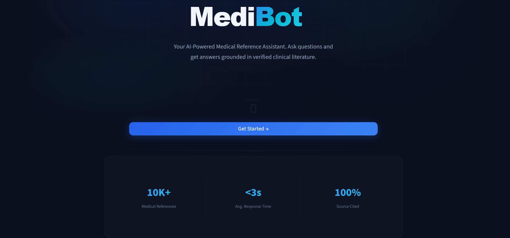

<div align="center">

# 🩺 MediBot — RAG-based Clinical Reference Assistant

A modular Retrieval-Augmented Generation (RAG) pipeline for medical Q&A. Ask questions about your local medical PDFs and get answers grounded in real documents, not hallucinations.

Powered by **FAISS** vector search + **Groq** LLM inference.



</div>

---

## 📋 Table of Contents

- [Architecture](#-architecture)
- [Quick Start](#-quick-start)
- [Installation](#%EF%B8%8F-installation)
- [Usage](#-usage)
- [Configuration](#-configuration)
- [Docker](#-docker)
- [Testing](#-testing)
- [Project Structure](#-project-structure)
- [Troubleshooting](#-troubleshooting)
- [Disclaimer](#%EF%B8%8F-disclaimer)

---

## 🏗️ Architecture

MediBot follows a modular RAG pipeline with three distinct layers:

```
┌─────────────────────────────────────────────────────────┐
│                    PRESENTATION LAYER                     │
│  ┌─────────────┐   ┌──────────────┐   ┌───────────────┐ │
│  │ Streamlit UI │   │   CLI Mode   │   │  FastAPI (opt)│ │
│  └──────┬──────┘   └──────┬───────┘   └───────┬───────┘ │
└─────────┼─────────────────┼───────────────────┼─────────┘
          │                 │                   │
┌─────────▼─────────────────▼───────────────────▼─────────┐
│                     APPLICATION LAYER                     │
│  ┌──────────┐  ┌──────────┐  ┌────────┐  ┌───────────┐  │
│  │  config  │  │    cli   │  │  app   │  │ evaluate  │  │
│  └──────────┘  └──────────┘  └────────┘  └───────────┘  │
└────────────────────────┬─────────────────────────────────┘
                         │
┌────────────────────────▼─────────────────────────────────┐
│                       RAG CORE                            │
│  ┌──────────┐  ┌───────────┐  ┌────────┐  ┌───────────┐ │
│  │ingestion │──►│vectorstore│──►│  llm   │──►│embeddings│ │
│  │  (PDF →  │  │(FAISS idx)│  │(Groq   │  │(Sentence- │ │
│  │  chunks) │  │           │  │ chain) │  │Transform) │ │
│  └──────────┘  └───────────┘  └────────┘  └───────────┘ │
└──────────────────────────────────────────────────────────┘
```

### Data Flow

```
                     ┌──────────────────┐
                     │   Medical PDFs    │
                     └────────┬─────────┘
                              ▼
                     ┌──────────────────┐
                     │  Chunk & Embed   │
                     │  (SentenceTrans.)│
                     └────────┬─────────┘
                              ▼
                     ┌──────────────────┐
                     │  FAISS Vector    │
                     │  Index           │
                     └────────┬─────────┘
                              │
  ┌────────────┐              │
  │ User Query │              │
  └──────┬─────┘              │
         ▼                    │
  ┌────────────────┐          │
  │  Embed Query   │          │
  └──────┬─────────┘          │
         ▼                    ▼
  ┌───────────────────────────────────┐
  │   Similarity Search (Top-K)       │
  └──────────────┬────────────────────┘
                 ▼
  ┌───────────────────────────────────┐
  │  Assemble Prompt + Context        │
  └──────────────┬────────────────────┘
                 ▼
  ┌───────────────────────────────────┐
  │  Groq LLM generates answer        │
  └──────────────┬────────────────────┘
                 ▼
  ┌───────────────────────────────────┐
  │  Answer + Source Citations        │
  └───────────────────────────────────┘
```

### Key Design Decisions

| Layer | Component | Role |
|-------|-----------|------|
| **Ingestion** | `ingestion.py` | Load PDFs with PyPDF, split into overlapping chunks |
| **Vector Store** | `vectorstore.py` | Build/load FAISS index, retrieve top-K passages |
| **Embeddings** | `embeddings.py` | HuggingFace SentenceTransformer model |
| **LLM** | `llm.py` | Groq-powered RAG chain with conversation history |
| **CLI** | `cli.py` | Command-line entry point: `ingest`, `query`, `web` |
| **UI** | `app.py` | Streamlit chat interface with streaming, citations, feedback |

This architecture keeps responses factual, traceable, and grounded in the source material — no hallucinations.

---

## 🚀 Quick Start

**1.** Clone and install:
```bash
git clone https://github.com/PradeepSomannavar/MedInfer.git
cd MedInfer
uv sync --extra dev
```

**2.** Set up your API keys:
```bash
cp .env.example .env
# Edit .env and add your GROQ_API_KEY
```

**3.** Drop your medical PDFs into `data/`:
```
data/
└── your-medical-book.pdf
```

**4.** Build the vector store:
```bash
uv run medibot ingest
```

**5.** Start chatting:
```bash
uv run medibot web     # Open Streamlit UI at http://localhost:8501
# or
uv run medibot query   # Use the terminal
```

---

## ⚙️ Installation

### Prerequisites

- Python 3.11 or higher
- A [Groq API key](https://console.groq.com/) (free tier available)

### Using uv (recommended)

[uv](https://github.com/astral-sh/uv) is a fast Python package manager.

```bash
# Install all dependencies
uv sync

# Include dev tools (pytest, ruff)
uv sync --extra dev
```

### Using pip

```bash
python -m venv .venv

# Activate (Linux/macOS)
source .venv/bin/activate

# Activate (Windows)
.venv\Scripts\activate

pip install -e ".[dev]"
```

---

## 💻 Usage

### Step 1 — Build the Vector Store

This is a one-time step (repeat whenever you add new PDFs):

```bash
uv run medibot ingest
```

This loads all PDFs from `data/`, splits them into chunks, creates embeddings, and saves the FAISS index to `vectorstore/db_faiss/`.

### Step 2 — Ask Questions

**Option A: Web Interface (recommended)**

```bash
uv run medibot web
```

Opens a chat UI at `http://localhost:8501` with:
- Medical disclaimer before first use
- Streaming responses
- Expandable source document citations
- Feedback buttons to rate answers
- Clear chat button in the sidebar

**Option B: CLI Mode**

```bash
uv run medibot query
```

A terminal-based chat loop. Type `quit` to exit. Each answer shows the source snippets that support it.

---

## 🔐 Configuration

All settings are controlled via environment variables. Copy `.env.example` to `.env`:

```bash
# Required
GROQ_API_KEY=gsk_xxxxxxxx

# Optional (shown with their defaults)
HF_TOKEN=                         # HuggingFace token (optional for public models)
EMBEDDING_MODEL=sentence-transformers/all-MiniLM-L6-v2
GROQ_MODEL=llama-3.1-8b-instant
CHUNK_SIZE=1000                   # Characters per text chunk
CHUNK_OVERLAP=150                 # Overlap between chunks
RETRIEVER_K=5                     # Number of passages retrieved per query
LLM_TEMPERATURE=0.3               # 0 = deterministic, 1 = creative
LLM_MAX_TOKENS=512                # Maximum response length
ENABLE_STREAMING=false            # Set true for token-by-token streaming
FAISS_INDEX_PATH=vectorstore/db_faiss
DATA_PATH=data/
```

---

## 🐳 Docker

Build and run MediBot as a containerized app:

```bash
docker build -t medibot .
docker run -p 8501:8501 \
  --env-file .env \
  -v $(pwd)/data:/app/data \
  medibot
```

The container includes the vector store built at image time. To rebuild the index with new PDFs, mount the `vectorstore/` directory or rebuild the image.

---

## 🧪 Testing

```bash
# Run all tests
uv run pytest tests/ -v

# Run with coverage
uv run pytest tests/ -v --cov=src

# Lint the codebase
uv run ruff check src/ tests/

# Check for formatting issues
uv run ruff format --check src/ tests/
```

---

## 📁 Project Structure

```
.
├── src/medibot/
│   ├── __init__.py        # Package version
│   ├── config.py          # Environment-driven configuration
│   ├── embeddings.py      # SentenceTransformer embedding model
│   ├── vectorstore.py     # FAISS index load and build
│   ├── ingestion.py       # PDF loading and text chunking
│   ├── llm.py             # Groq LLM + RAG chain with chat history
│   ├── cli.py             # CLI entry point (ingest / query / web)
│   └── app.py             # Streamlit web interface
├── tests/
│   ├── test_config.py     # Configuration validation
│   ├── test_ingestion.py  # Document chunking tests
│   └── test_vectorstore.py# FAISS index load and search tests
├── data/                  # Put your medical PDFs here
├── vectorstore/           # Generated FAISS index (gitignored)
├── pyproject.toml         # Project metadata and dependencies
├── Dockerfile             # Container build instructions
└── .env.example           # Required environment variables
```

---

## 🐛 Troubleshooting

| Problem | Cause | Fix |
|---------|-------|-----|
| `FAISS index not found` | Vector store hasn't been built yet | Run `uv run medibot ingest` |
| Empty or irrelevant answers | `k` too small or chunk size mismatch | Increase `RETRIEVER_K` to 5-10, adjust `CHUNK_SIZE` |
| LLM ignoring context | Temperature too high | Lower `LLM_TEMPERATURE` to 0.2-0.3 |
| `GROQ_API_KEY not set` | Missing `.env` file | Copy `.env.example` to `.env` and add your key |
| Streamlit won't start | Port 8501 already in use | Kill the existing process or set `streamlit.server.port` |
| Embedding model download fails | No internet or blocked HF | Set `HF_TOKEN` in `.env` or use a cached model path |

---

## ⚖️ Disclaimer

This tool is for **educational and reference purposes only**. It does **not** provide medical advice, diagnosis, or treatment recommendations. Always consult a licensed healthcare professional for medical decisions.
